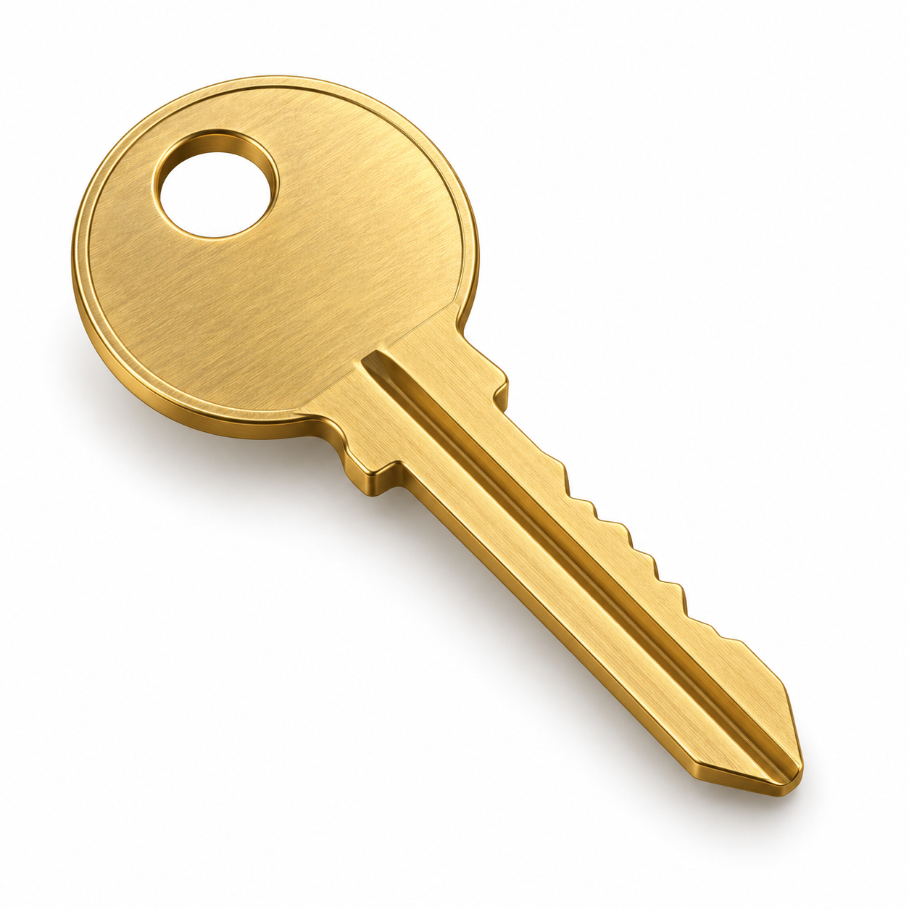
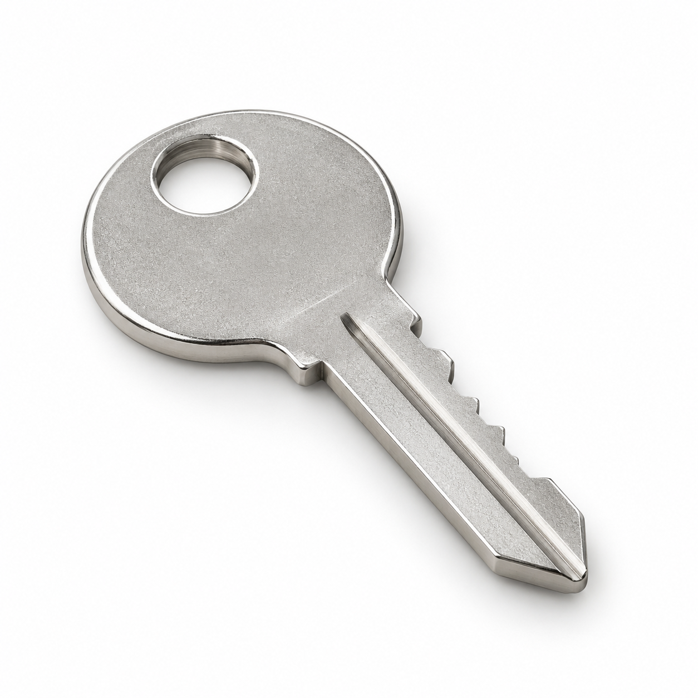
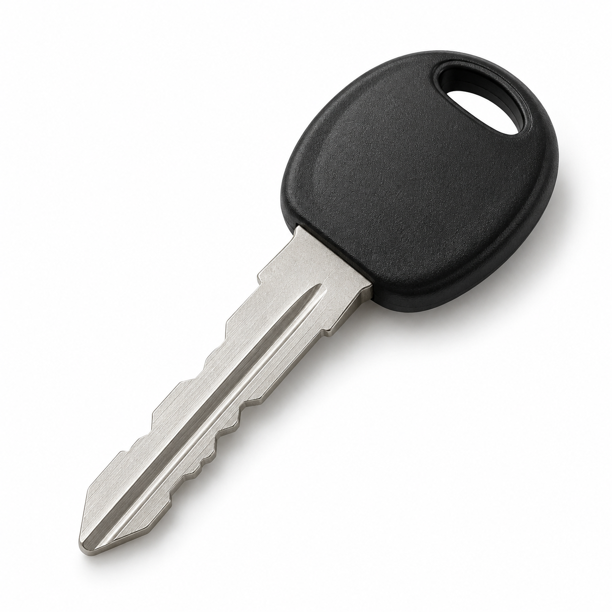
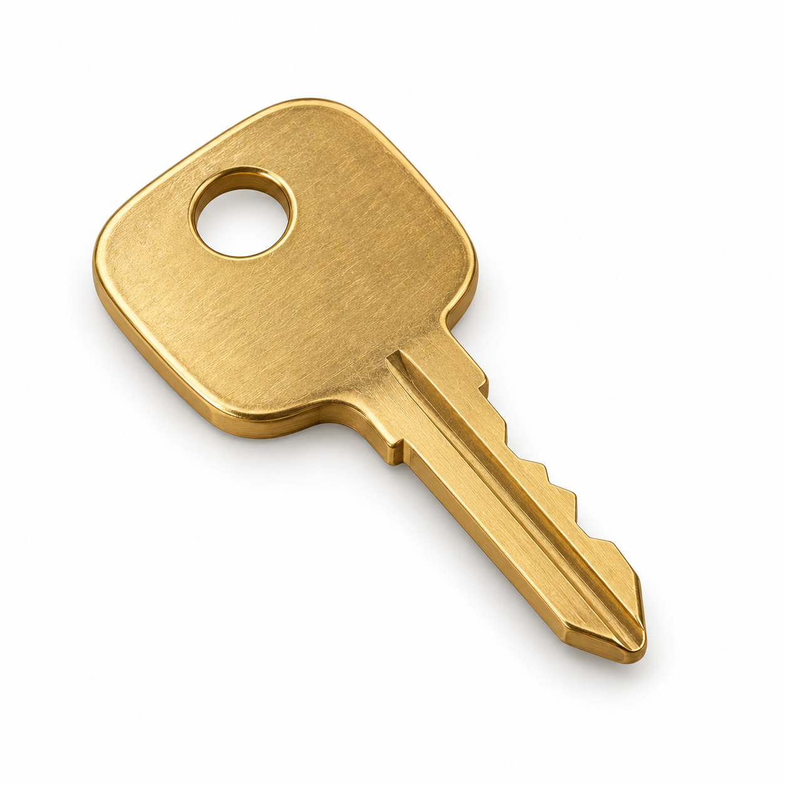
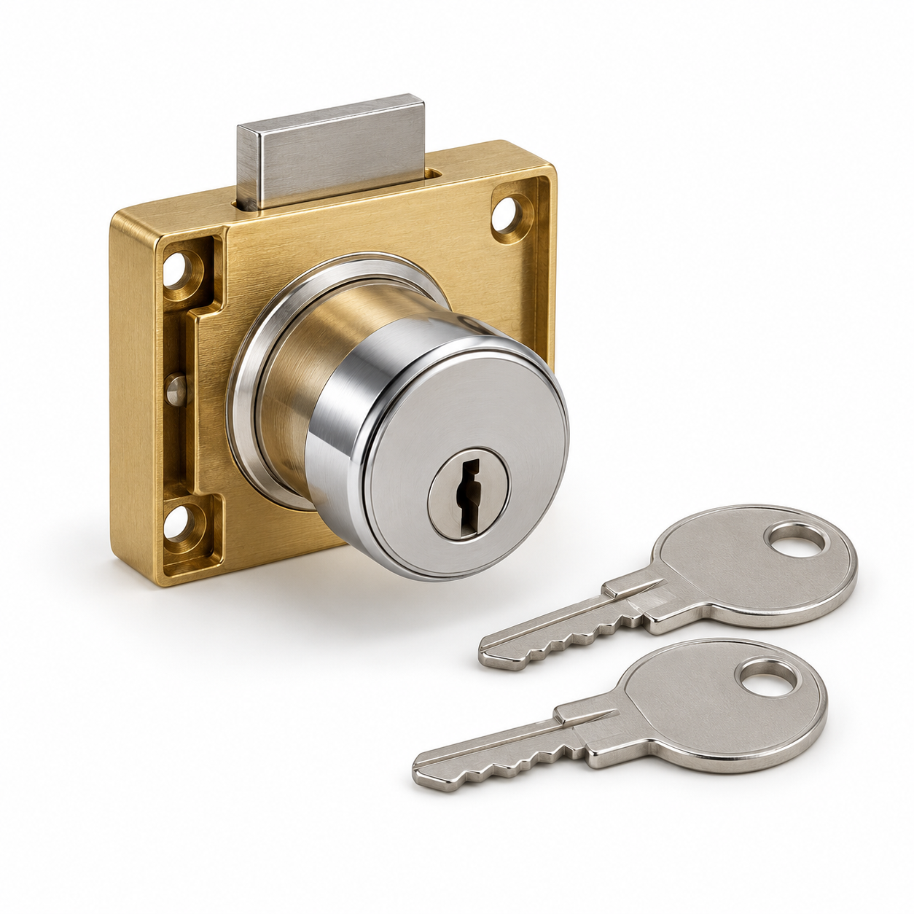

# Approved GMB additions — 25 October 2026

Status: **Owner-approved and published. Three added services, three public updates, HTTPS links and all 11 public products verified.**

Latest execution result: [GMB-PUBLICATION-2026-10-25.md](GMB-PUBLICATION-2026-10-25.md). The exact approved catalogue copy is retained below.

Business: **Key Maker & Locksmith — Electronic City**. Website: https://keymaker-ecity.alishanaver72.workers.dev/

This batch keeps all **29 existing services** and **six existing products**. It adds **three service entries, five physical products and three update posts**, corrects two older post buttons to the new site, and changes the profile website from HTTP to HTTPS.

## Approved scope and content assumptions

- The owner approved the exact batch and confirmed these five physical products are offered by the shop on 25 October 2026.
- All new product prices are omitted pending exact model and pricing confirmation; no zero/free placeholder is used.
- New products use disclosed representative illustrations, not competitors' photos or claims of actual stock.
- Existing 29 services and six products are retained.
- No category, address, phone, hours, review or discount changes are included.

## Three additional services

### Cupboard and almirah key duplication

Duplicate keys for compatible cupboards, almirahs, drawers and cabinets. Bring your original key so we can match the key profile and confirm the correct blank, cutting requirements and quote.

### Cupboard and cabinet lock replacement

Replacement of compatible cupboard, wardrobe and cabinet locks. Share the existing lock, door or drawer thickness and fitting details so we can check suitable parts and quote for the lock and installation.

### Door lock cylinder replacement

Replacement cylinders for compatible home, office and shop door locks. We check the cylinder size, fitting and supplied keys before quoting for the part and installation. Shop and on-site service are available.

## Five physical products

All prices are **left blank / request a quote**. New catalogue items are physical goods, not service-only listings. Photo files are saved under `product-images/` with the exact prompts and disclosure in `manifest-catalogue-2026-10-25.json`.

### Brass house key

Category: Keys and key blanks. Price: request quote.

Brass spare key for compatible house and door locks. Bring your original key so we can match the profile and confirm the correct blank and cutting requirements. Contact us for the final price before ordering. Representative AI-generated illustration; actual design may differ.

Landing page: https://keymaker-ecity.alishanaver72.workers.dev/#key-duplication

### Cupboard and almirah key

Category: Keys and key blanks. Price: request quote.

Spare key for compatible cupboards, almirahs, drawers and cabinets. Bring your original key or lock details to check the correct key profile and blank. Confirm compatibility, cutting requirements and the final price before purchase. Representative AI-generated illustration; actual design may differ.

Landing page: https://keymaker-ecity.alishanaver72.workers.dev/#key-duplication

### Mechanical bike spare key

Category: Car keys and remotes. Price: request quote.

Mechanical spare key for compatible motorcycles and scooters. Share the make, model and original key details to confirm the correct blank and cutting. This item is a mechanical key; chip keys and programming are quoted separately where supported. Confirm the final price. Representative AI-generated illustration; actual design may differ.

Landing page: https://keymaker-ecity.alishanaver72.workers.dev/#car-bike-keys

### Padlock spare key

Category: Keys and key blanks. Price: request quote.

Replacement or spare key for compatible padlocks. Bring the original key so we can match the key profile and confirm the correct blank and cutting requirements. Compatibility and the final price are checked before ordering. Representative AI-generated illustration; actual design may differ.

Landing page: https://keymaker-ecity.alishanaver72.workers.dev/#key-duplication

### Push-button cupboard lock

Category: Door locks. Price: request quote.

Mechanical push-button lock for compatible cupboards, cabinets and wardrobe doors. Share the existing lock, panel thickness and fixing details to check the correct fitting. Confirm the exact model, included keys, final price and installation charges before ordering. Representative AI-generated illustration; actual design may differ.

Landing page: https://keymaker-ecity.alishanaver72.workers.dev/#door-lock-repair

## Three update posts

All use a **Learn more** button. The website announcement uses the existing owner-selected storefront cover photo. No phone number is placed inside the post text.

### new-website

Our new website is live

Explore key duplication and locksmith services from Key Maker & Locksmith in Electronic City Phase 1, Bengaluru. Our website brings together our services, shop and work photos, opening hours, directions and FAQs, with direct call and WhatsApp booking options.

Visit our shop on Gollahalli Main Road, Siraj Layout, or contact us about on-site service in our listed areas. We are open 24 hours every day. Key and lock compatibility, availability, arrival time and the quote are confirmed for your job.

Tap Learn more to visit our new website.

Button: https://keymaker-ecity.alishanaver72.workers.dev/

### spare-key-checklist

Make a spare key before you need it

A working spare can make everyday access easier at home, at work or on the road. Bring your original house, cupboard or padlock key to our Electronic City Phase 1 shop so we can check the profile and suitable blank.

For a car or bike key, share the make, model, year and existing key details first. Mechanical cutting, transponder chips and remote programming have different requirements, so we check compatibility and confirm the quote before you order.

Open 24 hours on Gollahalli Main Road, Siraj Layout. Use Learn more for services, directions and WhatsApp booking.

Button: https://keymaker-ecity.alishanaver72.workers.dev/#key-duplication

### rekey-after-move

Moving in or changing access to your property?

If a key is missing or access needs to change, ask whether your existing lock can be rekeyed. For suitable locks, rekeying changes the key that operates the lock. Where rekeying is unsuitable, we can assess compatible replacement cylinders or locks.

Key Maker & Locksmith provides lock rekeying, repair and replacement for homes, offices and shops. Shop visits and on-site service are available around Electronic City and our listed areas, 24 hours a day.

Share the lock type and location so we can confirm parts, availability, arrival time and any fitting or travel charges. Work is for authorised owners and occupants. Tap Learn more for contact options.

Button: https://keymaker-ecity.alishanaver72.workers.dev/#rekeying-window-locks

## Website link corrections

- Profile website: `http://keymaker-ecity.alishanaver72.workers.dev/` → `https://keymaker-ecity.alishanaver72.workers.dev/`.
- Existing post `4833567883874943823`: Learn more → `https://keymaker-ecity.alishanaver72.workers.dev/` (text preserved).
- Existing post `4622446943236705301`: Learn more → `https://keymaker-ecity.alishanaver72.workers.dev/` (text preserved).

## Research and limits

Established local locksmith websites were used to check common customer needs, not to claim that any business is independently ranked number one. The catalogue avoids unconfirmed all-brand support, specialist ECU/EEPROM work, guaranteed arrival times and copied competitor photographs. No claim that more entries guarantee ranking is made.

- [BTM Key Makers](https://btmkeymakers.com/)
- [BLR Key Makers](https://blrkeymakers.com/)
- [MK Keys services](https://mkkeys.in/keys)
- [Google Services editor](https://support.google.com/business/answer/9455399?hl=en)
- [Google Product Editor](https://support.google.com/business/answer/9124203?hl=en-IN)
- [Google Posts](https://support.google.com/business/answer/7342169?hl=en)

## Execution and verification

The owner approved the full batch. All seven API actions succeeded; the three services, three public updates, two older post buttons and profile HTTPS website have subsequent browser verification. All five products were submitted and all 11 owner catalogue entries were verified. The fresh public View all products catalogue shows all 11 products, including all five additions. See the latest publication summary for evidence and detail checks. Google may review submissions before public display; submitted and publicly visible states are recorded separately.
