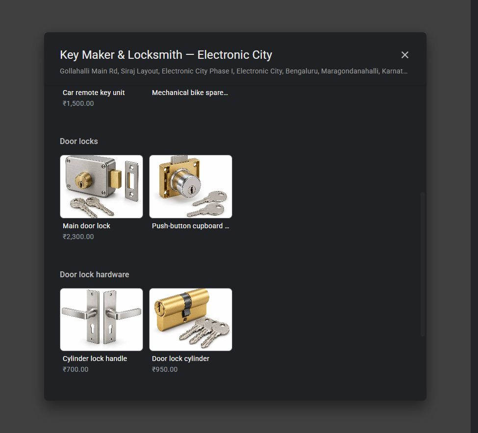
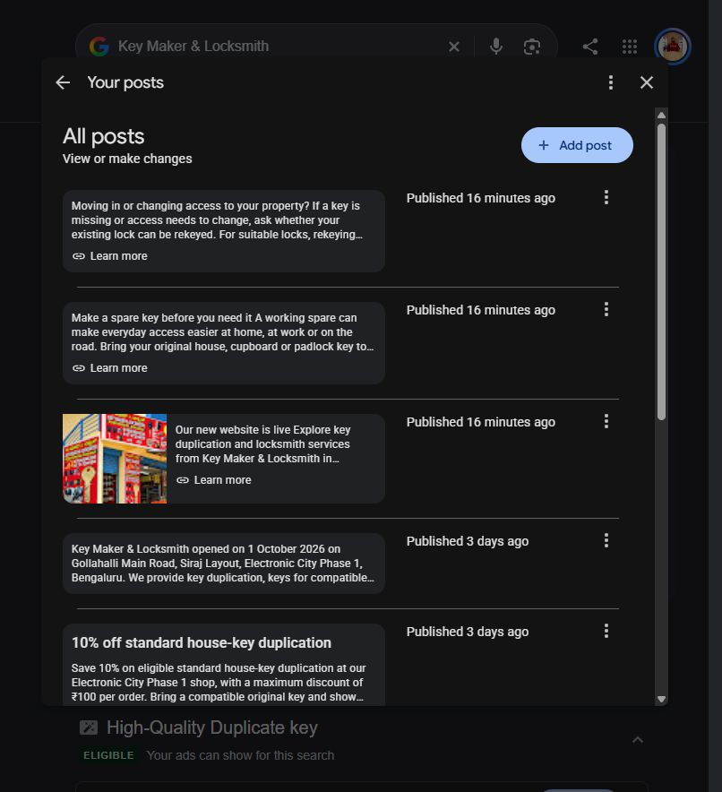

# GMB publication completed — 25 October 2026

The owner approved and published the full prepared batch for **Key Maker & Locksmith — Electronic City**. The customer-facing Google catalogue, service editor and post manager were checked after saving.

| Change | Final result |
| --- | --- |
| Five new physical products | All five publicly visible; **11 products total** |
| Three additional services | Saved; **32 services total**, with all 29 previous entries preserved |
| Three update posts | Owner manager shows **Published**; all three appeared on the public profile |
| Two older post buttons | Corrected to the new HTTPS website; existing text retained |
| Google Website field | Public button uses **https://keymaker-ecity.alishanaver72.workers.dev/** |

## Products

All five new descriptions and Visit site destinations match the approved copy exactly. The new items have no displayed price; customers request a quote. The six previous product prices remain unchanged.

- **Brass house key** — publicly visible; product ID `1038991472424218706`.
- **Cupboard and almirah key** — publicly visible; product ID `5703657306975089682`.
- **Mechanical bike spare key** — publicly visible; product ID `-3304064614033781608`.
- **Padlock spare key** — publicly visible; product ID `-625372604958387668`.
- **Push-button cupboard lock** — publicly visible; product ID `-7342334707077335483`.

The five added images are representative AI illustrations, with disclosure in each product description. The actual supplied design, compatibility and quote must be confirmed with the shop. Exact generation prompts and provenance are in `product-images/manifest-catalogue-2026-10-25.json`.

## Services

### Cupboard and almirah key duplication

Duplicate keys for compatible cupboards, almirahs, drawers and cabinets. Bring your original key so we can match the key profile and confirm the correct blank, cutting requirements and quote.

### Cupboard and cabinet lock replacement

Replacement of compatible cupboard, wardrobe and cabinet locks. Share the existing lock, door or drawer thickness and fitting details so we can check suitable parts and quote for the lock and installation.

### Door lock cylinder replacement

Replacement cylinders for compatible home, office and shop door locks. We check the cylinder size, fitting and supplied keys before quoting for the part and installation. Shop and on-site service are available.

All three descriptions were read back in Google's service editor and compared with the approved payload. The API's full-list update preserved all 29 previous entries and descriptions. No service prices were added or changed.

## Published updates

- **Our new website is live** — Learn more: https://keymaker-ecity.alishanaver72.workers.dev/
- **Make a spare key before you need it** — Learn more: https://keymaker-ecity.alishanaver72.workers.dev/#key-duplication
- **Moving in or changing access to your property?** — Learn more: https://keymaker-ecity.alishanaver72.workers.dev/#rekeying-window-locks

The website announcement uses the owner-selected storefront image. Both the older FAQ and shop-introduction posts now link to the new HTTPS homepage. The owner post manager shows all three new updates as Published. Initial PROCESSING responses and earlier cached readbacks are retained as history; the later browser checks establish completion.

## Evidence files

- `gbp-product-publication-2026-10-25.json` — five submission receipts and final public status.
- `gbp-products-public-readback-2026-10-25.json` — five exact product description/link comparisons.
- `gbp-public-catalogue-2026-10-25.txt` — complete public catalogue snapshot, including all 11 items.
- `gbp-services-browser-readback-2026-10-25.json` — exact saved service descriptions.
- `gbp-posts-public-readback-2026-10-25.json` — public post buttons, five Learn more links and HTTPS Website field.
- `gbp-posts-owner-published-2026-10-25.txt` — owner Published status labels.
- `gbp-api-publication-2026-10-25.json` — exact seven API write results and preserved baseline.

## Remaining work outside this batch

Final product pricing is still for the owner to supply. Public phone visibility, the remaining directory listing checks, SPARE10's precise expiry control and Search Console/Analytics verification remain separate follow-ups. No paid advertising, discounts, categories, address, phone or hours were changed in this batch. Publication does not guarantee ranking or AI recommendations.
